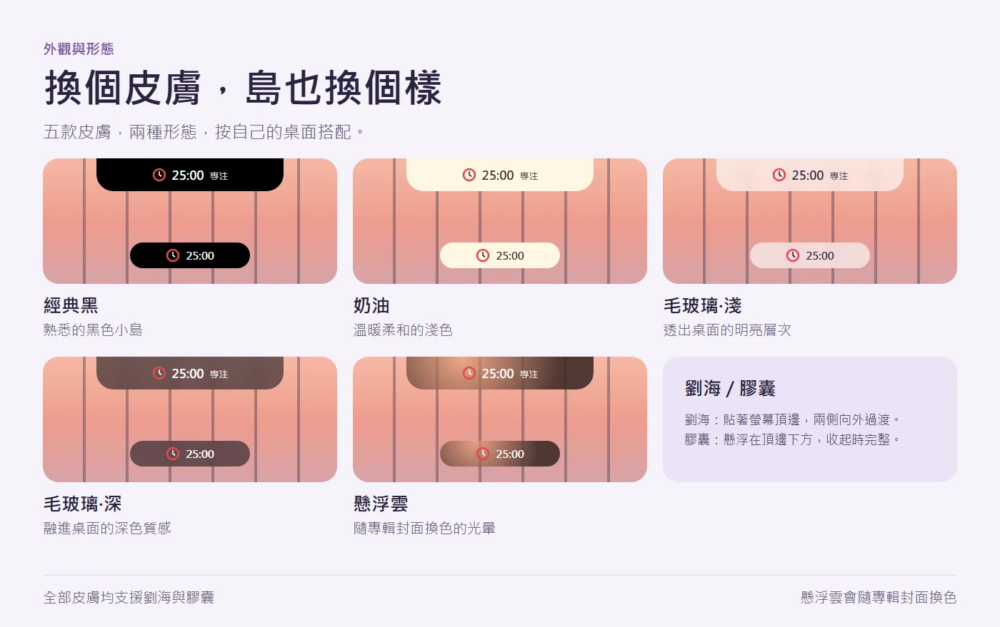
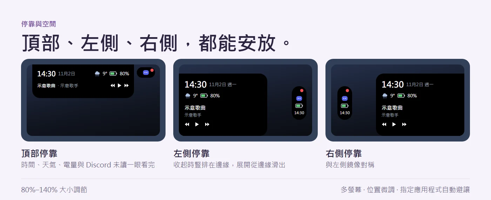
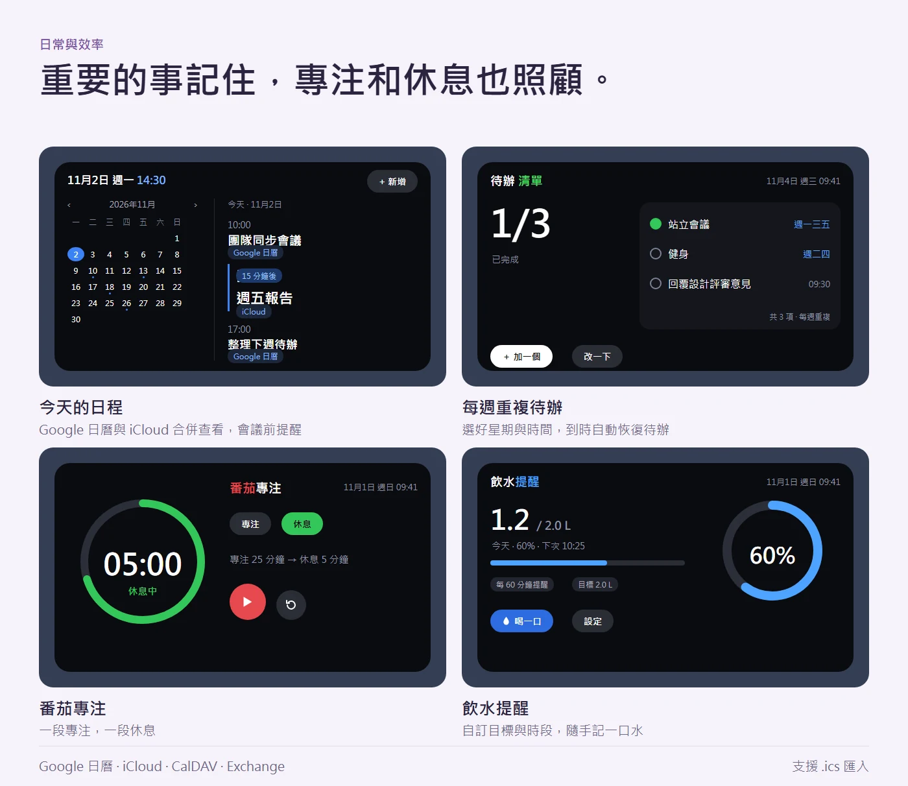
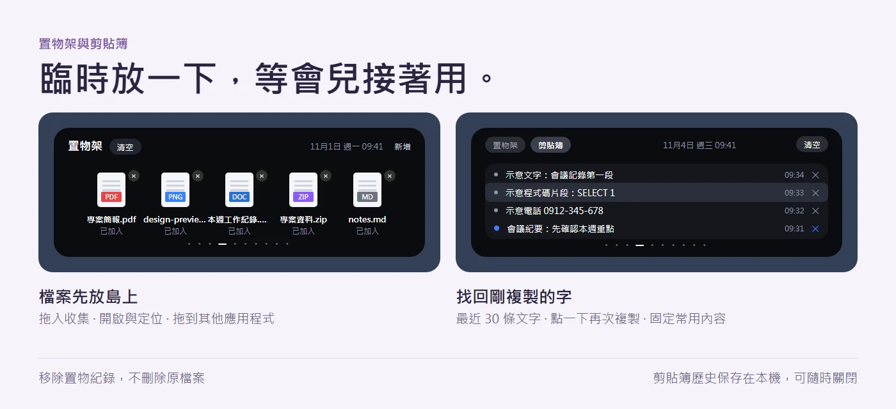
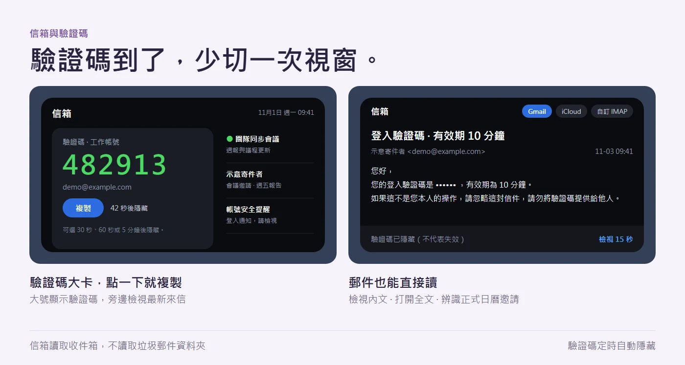
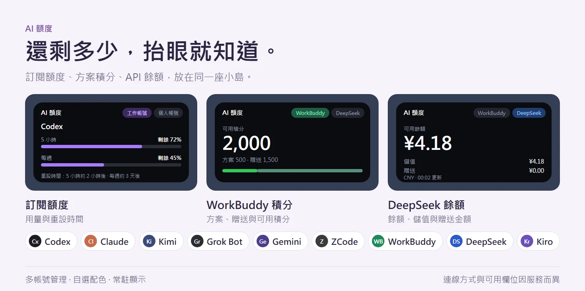

<div align="center">


# 島仔 · Daozai（臺灣在地化版）

**一座小島，裝下桌面日常。**

Windows 桌面夥伴，把訊息、音樂、日程、天氣和 AI 額度放到手邊。

[](https://github.com/binghao9312/daozai-tw/releases/latest)
[](#下載安裝)
[](LICENSE)
[](#從原始碼構建與參與開發)

**[下載 Windows 版](https://github.com/binghao9312/daozai-tw/releases/latest)** · [使用指南](docs/USAGE.md) · [更新記錄](CHANGELOG.md) · [反饋問題](https://github.com/binghao9312/daozai-tw/issues)

</div>

島仔是一款開源的 Windows 桌面小工具。平時收起在螢幕邊緣，滑鼠靠近就展開；切歌、看日程、複製驗證碼、記一條待辦，都能順手完成。小島裡的夥伴會眨眼、打盹、喝水，也會跟著音樂唱歌。

你可以選劉海或膠囊，放在頂部、左側或右側，只保留自己需要的功能。島仔使用 Rust 和 egui 構建，不依賴 Electron。

本倉庫是**臺灣在地化版**：介面為繁體中文；訊息提醒改為 Discord；音樂控制與歌詞改用 YouTube Music 與 LRCLIB；郵件與日程改用 Gmail 與 Google 日曆；天氣可選臺灣中央氣象署（CWA）。微信、QQ、飛書、釘釘、網易雲等中國服務的功能已停用或移除。

## Discord 有新訊息，看一眼島邊

- **Discord 未讀提醒**：收起時亮起圖示和紅點，展開後點選即可喚起 Discord 主視窗；視窗最小化到系統系統匣時同樣可以喚起。
- **只監聽 Discord 桌面版**：同時相容 Discord PTB 與 Canary。
- **預設隱藏通知正文**：開啟預覽後仍遮罩識別出的驗證碼。

開啟方式：**設定 → 通知、郵件與日程 → 通知**，並確認 Discord 桌面版已開啟 Windows 系統通知。

微信、QQ 等舊版中國 IM 的提醒程式碼仍保留在原始碼中，但預設不啟用，需要時以 `cn-messengers` 功能編譯。

## 換個皮膚，也換個位置



**五款皮膚 × 兩種形態，自由搭配。** 經典黑、奶油、毛玻璃·淺、毛玻璃·深和「懸浮雲」，都能搭配劉海或膠囊。毛玻璃透出身後的桌面；懸浮雲隨專輯封面換色，光暈跟著滑鼠移動。



- **三邊停靠**：頂部橫向展開，左右側邊收起為豎向膠囊，靠近後從螢幕邊緣展開。
- **大小與位置可調**：島體大小支援 80%–140%；頂部可左右移動，側邊可上下調整。
- **OLED 畫素偏移**（預設關閉）：收起靜止時沿停靠邊緩慢移動幾個畫素，幫助減輕 OLED 靜態顯示留下的痕跡。
- **多屏與自動避讓**：跟隨主屏或固定到指定顯示器；指定應用覆蓋小島時，可自動收成貼邊細線。
- **按習慣顯示**：支援極簡模式、12／24 小時制，以及功能頁面開關與拖動排序。

在 **設定 → 常規 → 島體外觀／島體顯示** 中調整。島上單行歌詞目前支援頂部停靠。

## 聽歌時，歌詞就在抬眼處


播放、暫停、切歌、調節音量和拖動進度，都能在島上操作。展開看歌詞，也可以收起後只留一行歌詞，讓桌面繼續做自己的事。

- 透過 Windows 媒體會話（SMTC）讀取播放訊息，可識別 **YouTube Music**：Chrome、Edge、Brave 網頁版，以及 YouTube Music 桌面版、Pear Desktop 等。
- 歌詞以 **LRCLIB** 為主要來源，免金鑰：先按歌名、歌手與時長精確查詢，找不到再模糊搜尋。
- 所有播放器都暫停時，控制按鈕仍指向**上一個播放來源**，不會跳到其他暫停中的播放器。
- 網易雲、QQ 音樂、酷狗、汽水音樂的私有歌詞介面已移除。

播放器需提供可用的媒體訊息；歌詞取決於歌曲後設資料與 LRCLIB 的收錄情況，個別歌曲可能無法顯示。

## 日程、待辦和專注，放在一起



| 想做的事 | 島仔能幫你 |
| --- | --- |
| 看今天的安排 | 月曆與當日時間線，合併多個日曆和正式郵件邀請，提前提醒會議 |
| 記住每週的事 | 待辦支援單次提醒、每週指定日期重複或每天重複；下一次到來時恢復為待辦 |
| 專心做一件事 | 專注與休息計時，收起時也能檢視進度 |
| 記得喝水 | 自定義每日目標、單次飲水量、提醒間隔與時段，記錄錯誤可撤銷 |

日曆可接入 **Google 日曆（.ics 私密網址或 CalDAV）、iCloud、自定義 CalDAV 和 Exchange ActiveSync**，也能匯入 `.ics` 檔案。相同日程合併去重；支援全天、跨天和重複日程。

本機新建或匯入的日程儲存在本機；遠端日曆為只讀同步。程式退出、電腦關機或睡眠期間無法持續提醒。

## 檔案先放島上，剛複製的字也能找回



**檔案置物架**：拖入檔案臨時收集，點選開啟、定位原檔案，或拖出到其他應用。移除記錄不會刪除原檔案。

**文字剪貼簿**：找回最近複製的 30 條文字，點一下重新複製，常用內容可以固定。歷史儲存在本機，重啟後仍可檢視；可在 **設定 → 待辦與置物 → 剪貼簿** 中關閉。密碼管理器標記為敏感的內容不記錄。

## 驗證碼少切一次視窗，郵件也能直接讀



連線多個信箱，在島上檢視來信、識別驗證碼並點選複製。郵件支援正文閱讀與獨立全文視窗，網頁連結交給預設瀏覽器開啟；正式日曆邀請可進入日程。支援已讀／未讀切換、全部已讀、移到回收站及恢復；預設僅在本機整理，可在郵件設定中開啟「同步郵件操作到信箱」。

支援 **Gmail、iCloud 和自定義 IMAP**。已儲存的 QQ、163 等舊帳號仍可讀取，但新增帳號時不再提供這些選項。驗證碼可設定在 30／60／300 秒後自動隱藏，覆蓋列表、正文與通知；主動檢視後會再次隱藏。

## AI 還剩多少額度，抬眼就知道



支援 **Codex、Claude、Kimi、Grok Bot、Gemini、ZCode、WorkBuddy、DeepSeek 和 Kiro**。

訂閱額度、重置時間、套餐積分與 API 餘額，按服務展示。多個帳號可分別命名、選擇配色，常用帳號直接放在收起的小島上。

- **ZCode**：檢視套餐額度。
- **Claude**：只讀取桌面版本地用量歷史與快取，或接收 Claude Code 官方狀態列輸出；島仔不使用 Claude 登入令牌，也不請求 Claude 額度介面。資料隨官方客戶端使用更新，桌面版快取有效時自動顯示重置時間，讀取不到時顯示未知。
- **Kiro**：只讀識別 Kiro 登入快取並核驗使用者，顯示套餐、有效試用與贈送 / 加購點數及明細，超額上限單獨顯示；支援美國東部和歐洲中部區域。不自動續期，登入過期時請在 Kiro 中重新登入。
- **WorkBuddy**：檢視剩餘積分；優先識別本機客戶端登入，也可在預設瀏覽器完成授權。
- **Gemini**：支援 Chrome 144+ 原生授權連線，讀取官網的 5 小時與每週額度，無需擴充套件。先在 Chrome 登入 Gemini，首次在 `chrome://inspect/#remote-debugging` 開啟連線，回島仔點選連線並在 Chrome 允許授權；會話加密儲存在本機，後續獨立重新整理。高階設定保留手動 Cookie 連線。
- **DeepSeek**：使用 API Key 連線，檢視賬戶餘額、充值與贈送金額。
- **中轉站**：自動識別通用餘額、New API 和 Sub2API，保留 One API 相容計費介面；New API 可用使用者 Token 查詢賬戶餘額。高階設定支援貼上 CC Switch 的 `request` / `extractor` 自定義查詢指令碼，指令碼與憑據加密儲存在本機。

連線方式、可用欄位與帳號訂閱有關；請求失敗或登入過期時，以對應服務的官方頁面為準。

## 出門前先看一眼天氣

天氣頁顯示當前實況與未來七天預報：溫度、天氣現象、體感、溼度、風速、日出日落時間，以及每天的最高／最低溫和降水機率。

- **資料來源**：預設使用 **Open-Meteo**（免費、無需金鑰）。也可以在 **設定 → 天氣** 改用 **臺灣中央氣象署（CWA）**：到 [CWA OpenData 申請授權碼](https://opendata.cwa.gov.tw/user/authkey)，填入後即可；授權碼儲存在 Windows 憑據管理器。
- **城市**：支援臺灣 22 縣市，預設優先高雄市、臺南市、臺北市。也可以輸入城市名，按回車或點「重新整理天氣」後生效。
- **定位**：預設按當前網路出口自動定位，主服務失敗時嘗試備用服務；點「自動定位」可清除手動城市。
- **重新整理頻率**：Open-Meteo 每 15 分鐘自動更新；CWA 每小時更新，失敗後 30 分鐘重試。同一城市請求間隔至少 30 秒，失敗後至少 2 分鐘；關閉天氣模組後停止後續自動查詢。
- 結果快取在本機：斷網時繼續顯示上次的資料，並用橙色標出更新時間。
- 島收起時常駐欄預設在時間後面顯示天氣圖示和當前溫度（如 `🌧 9°`），點它直接進天氣頁；可在「頁面管理 → 常駐排列」中獨立拖動天氣，在「狀態元件」中單獨關閉常駐天氣，天氣頁仍可使用。

## 還有這些順手的小功能

電源與電量、網路變化、音量、大寫鎖定、輸入語言、藍芽裝置狀態，都能在小島上提示。通知、藍芽監聽與不常用的功能頁可以按需關閉。

## 下載安裝

前往 **[最新正式版](https://github.com/binghao9312/daozai-tw/releases/latest)**，按使用習慣選擇：

| 下載檔案 | 使用方式 |
| --- | --- |
| `Daozai-Setup-v版本號-x64.exe` | **推薦**。雙擊安裝，可選擇安裝位置、桌面快捷方式和開機自動啟動 |
| `Daozai-v版本號-windows-x64.zip` | 免安裝。完整解壓後執行 `daozai.exe`，使用者資料仍儲存在應用資料目錄 |
| `SHA256SUMS.txt` | 下載校驗，可用 PowerShell `Get-FileHash -Algorithm SHA256` 比對 |

首次安裝預設建立桌面快捷方式、不開機自動啟動。安裝後從小島或系統匣開啟設定，選擇需要的功能和連線。

**更新**：設定 → 關於 → 檢查更新。支援應用內下載、校驗後重啟更新，也可從釋出頁下載覆蓋安裝；升級保留原設定和資料，解除安裝同樣保留使用者資料。

**系統**：Windows 10／11 x64。預設使用 OpenGL，初始化失敗時自動嘗試 Direct3D 12。Windows 11 已進行本機實測，Windows 10、不同顯示卡及多屏組合仍需更多反饋。暫不提供 macOS、Linux 或 ARM64 成品包。

當前程式未做商業程式碼簽名，Windows 可能提示未知釋出者；請核對倉庫來源與檔案校驗值。更多操作見 [使用指南](docs/USAGE.md)。

<details>
<summary><b>連線服務之前，需要準備什麼？</b></summary>

| 型別 | 支援入口 | 需要準備 |
| --- | --- | --- |
| 信箱 | Gmail、iCloud、自定義 IMAP | 啟用 IMAP；Gmail 需使用應用專用密碼；自定義服務可填寫伺服器、埠與登入使用者名稱 |
| 日曆 | Google 日曆（.ics 私密網址或 CalDAV）、iCloud、CalDAV、Exchange ActiveSync | 服務商提供的日曆同步憑據與必要的伺服器地址；安裝桌面客戶端不等於授權 |
| AI 額度 | Codex、Claude、Kimi、Grok Bot、Gemini、ZCode、WorkBuddy、DeepSeek、Kiro | 對應客戶端登入、獨立授權或 API Key；具體以設定中的連線入口為準 |

Gmail 與 Google 日曆尚未完成真實帳號驗收；iCloud、CalDAV、Exchange 的可用性與服務端配置、許可權和相容性有關。

</details>

<details>
<summary><b>資料與隱私</b></summary>

- 設定、待辦、本機日程、飲水記錄、剪貼簿歷史、置物路徑與連線後設資料儲存在 `%APPDATA%\Daozai`。
- 信箱和日曆密碼、DeepSeek API Key 儲存在 Windows 憑據管理器；獨立 Gemini、WorkBuddy 會話使用 Windows DPAPI 加密。
- Discord 提醒依賴系統通知許可權；預設隱藏通知正文。
- 讀取已有 AI 客戶端登入時不回寫原客戶端配置。不要把授權碼、Cookie、API Key 或登入 JSON 上傳到 Issue。
- 信箱讀取收件箱，不讀取垃圾郵件資料夾；郵件正文在當前程序中用於展示和識別。
- 島仔沒有自建的郵件或日程上傳後臺；開啟聯網功能後，會訪問對應服務商與歌詞服務。
- 天氣預設用城市名或定位得到的經緯度查詢 Open-Meteo；選用 CWA 時使用授權碼查詢臺灣中央氣象署。自動定位透過 `ipwho.is`，失敗時嘗試 FreeIPAPI，不讀取帳號訊息。

完整說明見 [隱私與安全](docs/PRIVACY.md)。

</details>

<details>
<summary id="從原始碼構建與參與開發"><b>從原始碼構建與參與開發</b></summary>

需要 Rust stable、MSVC C++ 構建工具和 Windows SDK。

```powershell
rustup default stable-x86_64-pc-windows-msvc
cargo build --locked --release --bin daozai
.\target\release\daozai.exe
```

執行測試及打包：

```powershell
cargo test --locked --all-targets --features record -- --test-threads=1
powershell -NoProfile -ExecutionPolicy Bypass -File .\scripts\package.ps1
```

測試按單執行緒執行，以隔離使用程序環境變數的資料目錄測試。低記憶體裝置可設定 `$env:CARGO_BUILD_JOBS = "1"`。打包需要 NSIS 3，可透過 `-NsisCompiler` 指定 `makensis.exe`。

專案結構、介面預覽與貢獻方式見 [開發指南](CONTRIBUTING.md)。

</details>

## 開源與致謝

島仔原創程式碼採用 [MIT License](LICENSE)。本倉庫是臺灣在地化分支，基於原始開源專案修改，原作者版權宣告保留在 LICENSE 中；本分支不提供原專案的下載、更新或贊助入口。Rust 依賴、vendored 程式碼、第三方圖示及品牌標識沿用各自的許可或權利宣告；MIT 不授予服務商標使用權，也不代表官方合作或認證。詳見 [第三方宣告](THIRD_PARTY_NOTICES.txt) 和 [依賴說明](docs/DEPENDENCIES.md)。

「懸浮雲」皮膚作者：啵（[@hanhb123](https://github.com/hanhb123)）。感謝 egui／eframe、Rust 社群，以及提供參考與素材的開源專案。

## 感謝支援

喜歡這個分支的話，歡迎到 [binghao9312/daozai-tw](https://github.com/binghao9312/daozai-tw) 點一個 **Star**，也歡迎回報問題與建議。

